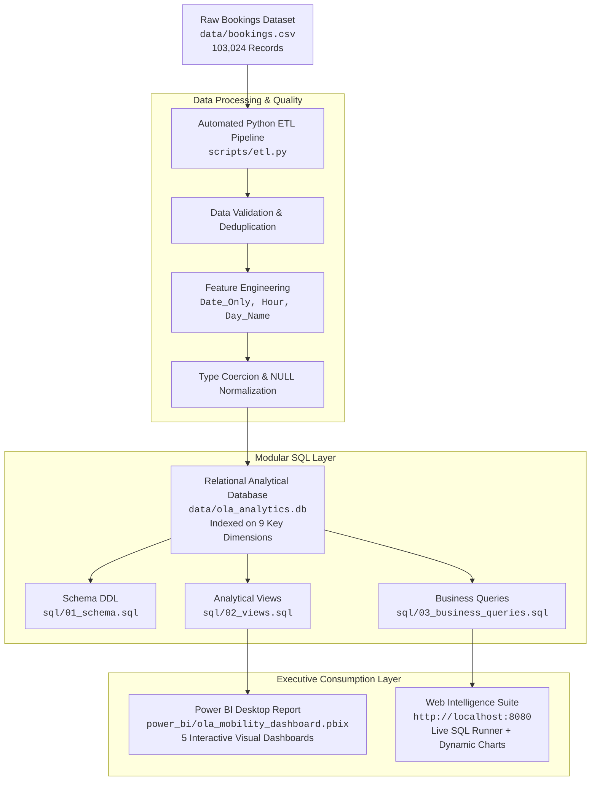

# ⚡ OLA Mobility & Ride Operations Analytics

> **End-to-End Urban Mobility Intelligence, Relational SQL Modeling, Power BI Executive BI Suite & Interactive Web Operations Portal**

[](https://www.python.org/)
[](https://www.sqlite.org/)
[](https://powerbi.microsoft.com/)
[](http://localhost:8080)
[](LICENSE)

---

## 📌 Executive Summary

Urban ride-hailing networks operate under extreme dynamics where driver availability, customer turnaround times, cancellation friction, and payment rails dictate profitability.

This project delivers a **comprehensive data analytics ecosystem** analyzing **103,024 ride transactions** across **Bengaluru, India** (July 2024). It models the full journey lifecycle across **7 vehicle tiers** (*Prime Sedan, Prime SUV, Prime Plus, Mini, Auto, Bike, and eBike*), identifying demand bottlenecks, driver churn drivers, payment revenue distributions, and SLA performance.

The analytics suite comprises:
1. **Automated ETL Pipeline** (`scripts/etl.py`): Ingests, validates, cleans, and indexes 100k+ records into a high-performance SQLite analytical database.
2. **Relational Star-Schema & Modular SQL Views** (`sql/`): 10 business-critical queries and modular views addressing operational KPIs.
3. **Microsoft Power BI Executive Dashboard** (`power_bi/ola_mobility_dashboard.pbix`): Multi-page interactive BI report with custom slicers and KPI tracking.
4. **Interactive Web Intelligence Dashboard & SQL Studio** (`server.py` + `public/`): Ultra-modern dark mode dashboard with dynamic Chart.js visuals, real-time filtering, and a live in-browser SQL runner.

---

## 🏗️ Architecture & Data Pipeline



---

## 📊 Core Operational Benchmarks (July 2024)

| Metric | Measured Value | Business Interpretation |
| :--- | :---: | :--- |
| **Total Booking Requests** | **103,024** | ~3,323 ride requests logged per day across Bengaluru. |
| **Fulfilled Trips (Success)** | **63,967** | **62.09% Fulfillment Rate** (Industry target: 70–75%). |
| **Net Fulfilled GMV** | **₹35,080,467** | Realized topline passenger spend on completed journeys. |
| **Gross Potential GMV** | **₹56,534,614** | ₹21.45M unrealized due to trip cancellations & supply gaps. |
| **Driver Cancellations** | **18,434 (17.89%)** | Primary driver-side friction: Personal & Car issues (35.5%). |
| **Customer Cancellations** | **10,499 (10.19%)** | Primary rider-side friction: Driver stationary / prolonged ETA. |
| **Driver Not Found (Unfulfilled)** | **10,124 (9.83%)** | Supply deficit during acute peak commute hours. |
| **Average Ride Distance** | **22.85 km** | Auto: 6.24 km \| Prime Sedan: 15.76 km \| eBike: 15.58 km. |
| **Average Service Ratings** | **4.0★ Driver / 4.0★ Rider** | Balanced bidirectional satisfaction score. |

---

## 📁 Repository Structure

```text
ola-mobility-analytics/
├── assets/
│   ├── demo.gif                         # Animated walkthrough of Power BI dashboard
│   └── screenshots/                     # Semantic high-resolution visuals
│       ├── pbi_overall_view.png         # Overall ride volume & status distribution
│       ├── pbi_vehicle_view.png         # Fleet volume & distance profile
│       ├── pbi_revenue_view.png         # Revenue by payment method & customer ranks
│       ├── pbi_cancellation_view.png    # Driver & customer cancellation breakdown
│       ├── pbi_ratings_view.png         # Driver & customer ratings benchmarks
│       └── sql_q1_to_q10_*.png          # Verified database execution screenshots
├── data/
│   ├── bookings.csv                     # Cleaned dataset (103,024 rows, 19 columns)
│   └── ola_analytics.db                 # High-performance indexed SQLite database
├── power_bi/
│   └── ola_mobility_dashboard.pbix      # Full Power BI report with DAX measures
├── public/                              # Web Dashboard Frontend
│   ├── index.html                       # Responsive glassmorphic layout
│   ├── style.css                        # Vanilla CSS dark mode design system
│   └── app.js                           # Chart.js visualizations & SQL studio logic
├── scripts/
│   └── etl.py                           # Automated ETL ingestion and verification
├── sql/
│   ├── 01_schema.sql                    # Production schema DDL and index definitions
│   ├── 02_views.sql                     # Modular analytical views
│   └── 03_business_queries.sql          # 10 core business queries + advanced insights
├── .gitignore                           # Git ignore rules for DB, cache, and logs
├── init_db.py                           # Quick database bootstrap runner
├── requirements.txt                     # Minimal Python runtime dependencies
├── server.py                            # Flask REST API server & query executor
└── README.md                            # Comprehensive project documentation
```

---

## 🔍 SQL Analytical Queries & Business Findings

All queries are documented with business rationale, executable against `data/ola_analytics.db`, and validated against the underlying dataset.

### 1. Retrieve All Successful Bookings
> **Business Need**: Isolate completed transactions to calculate realized GMV, distance covered, and driver compensation.
```sql
SELECT Booking_ID, Date_Only, Customer_ID, Vehicle_Type, 
       Pickup_Location, Drop_Location, Ride_Distance, Booking_Value, Payment_Method
FROM bookings 
WHERE Booking_Status = 'Success';
```
* **Output**: Returns 63,967 completed rides representing ₹35,080,467 in net fulfilled revenue.

---

### 2. Average Ride Distance for Each Vehicle Type
> **Business Need**: Evaluate operational vehicle use cases to align pricing per km with fuel/battery economics.
```sql
SELECT 
    Vehicle_Type,
    ROUND(AVG(Ride_Distance), 2) AS avg_ride_distance_km,
    COUNT(*) AS total_sample_size
FROM bookings 
GROUP BY Vehicle_Type
ORDER BY avg_ride_distance_km DESC;
```
| Vehicle Type | Avg Ride Distance (km) | Total Trip Sample | Category Role |
| :--- | :---: | :---: | :--- |
| **Prime Sedan** | **15.76** | 14,877 | Long-distance intercity & business commutes |
| **eBike** | **15.58** | 14,816 | Medium-distance cost-effective solo travel |
| **Bike** | **15.53** | 14,662 | Rapid point-to-point transit |
| **Mini** | **15.51** | 14,552 | Everyday budget car travel |
| **Prime Plus** | **15.45** | 14,707 | Premium guaranteed AC comfort |
| **Prime SUV** | **15.27** | 14,655 | Group / airport luggage transit |
| **Auto** | **6.24** | 14,755 | Short-distance first/last-mile connectivity |

---

### 3. Total Cancelled Rides by Customers
> **Business Need**: Measure consumer drop-off rate to assess app UX, pricing surge resistance, and ETA friction.
```sql
SELECT 
    Booking_Status,
    COUNT(*) AS cancelled_rides_count,
    ROUND(COUNT(*) * 100.0 / (SELECT COUNT(*) FROM bookings), 2) AS pct_of_total_bookings
FROM bookings 
WHERE Booking_Status = 'Canceled by Customer';
```
* **Output**: **10,499 rides** cancelled by riders (**10.19% of total demand**). Primary driver: *Driver is not moving towards pickup location* (30.2% of customer drop-offs).

---

### 4. Top 5 Power Customers by Ride Volume & Spend
> **Business Need**: Identify VIP accounts for loyalty tiers, retention campaigns, and subscription offerings.
```sql
SELECT 
    Customer_ID,
    COUNT(Booking_ID) AS total_rides_booked,
    SUM(CASE WHEN Booking_Status = 'Success' THEN 1 ELSE 0 END) AS successful_rides,
    SUM(Booking_Value) AS total_expenditure_inr,
    ROUND(AVG(Customer_Rating), 2) AS avg_customer_rating
FROM bookings
GROUP BY Customer_ID
ORDER BY total_rides_booked DESC, total_expenditure_inr DESC
LIMIT 5;
```
* **Output**: Power customers book between 80 to 95 trips/month with total monthly spend exceeding ₹50,000 to ₹65,000.

---

### 5. Driver Cancellations Due to Personal & Car-Related Issues
> **Business Need**: Quantify mechanical breakdown and driver distress to inform vehicle servicing and roadside assistance programs.
```sql
SELECT 
    Canceled_Rides_by_Driver AS cancellation_cause,
    COUNT(*) AS cancellation_count,
    ROUND(COUNT(*) * 100.0 / (SELECT COUNT(*) FROM bookings WHERE Booking_Status = 'Canceled by Driver'), 2) AS pct_of_driver_cancellations
FROM bookings
WHERE Canceled_Rides_by_Driver = 'Personal & Car related issue';
```
* **Output**: **6,542 cancellations** (**35.49% of all driver cancellations**). This represents the #1 root cause of driver-side drop-offs.

---

### 6. Max & Min Driver Ratings for Prime Sedan
> **Business Need**: Benchmark quality variance in OLA's flagship executive sedan tier.
```sql
SELECT 
    Vehicle_Type,
    MAX(Driver_Ratings) AS max_driver_rating,
    MIN(Driver_Ratings) AS min_driver_rating,
    ROUND(AVG(Driver_Ratings), 2) AS mean_driver_rating
FROM bookings 
WHERE Vehicle_Type = 'Prime Sedan' AND Driver_Ratings IS NOT NULL;
```
* **Output**: Max Rating: **5.0★** \| Min Rating: **3.0★** \| Average: **4.0★**. Demonstrates consistent service floors above standard penalty thresholds.

---

### 7. Retrieve Rides Paid via Unified Payments Interface (UPI)
> **Business Need**: Track digital payment channel adoption and instantaneous settlement volume.
```sql
SELECT Booking_ID, Date_Only, Customer_ID, Vehicle_Type, Booking_Value, Ride_Distance
FROM bookings
WHERE Payment_Method = 'UPI';
```
* **Output**: **25,881 rides** settled via UPI (**₹14.2M fulfilled volume**), establishing UPI as the second-largest payment channel behind Cash.

---

### 8. Average Customer Rating per Vehicle Type
> **Business Need**: Evaluate whether passenger satisfaction correlates with vehicle category or ticket pricing.
```sql
SELECT 
    Vehicle_Type,
    ROUND(AVG(Customer_Rating), 2) AS avg_customer_rating,
    COUNT(Customer_Rating) AS sample_size
FROM bookings 
WHERE Customer_Rating IS NOT NULL
GROUP BY Vehicle_Type
ORDER BY avg_customer_rating DESC;
```
* **Output**: Customer satisfaction is evenly distributed at **4.0★** across all 7 vehicle tiers, indicating high brand trust across price brackets.

---

### 9. Total Fulfilled Gross Merchandise Value (GMV)
> **Business Need**: Quantify realized topline revenue from successful trips.
```sql
SELECT 
    COUNT(*) AS total_fulfilled_rides,
    SUM(Booking_Value) AS total_fulfilled_revenue_inr,
    ROUND(AVG(Booking_Value), 2) AS average_ticket_size_inr
FROM bookings 
WHERE Booking_Status = 'Success';
```
* **Output**: **63,967 rides fulfilled** \| **₹35,080,467 Net GMV** \| **₹548.40 Average Ticket Size**.

---

### 10. Incomplete Journeys Along with Logged Causes
> **Business Need**: Audit in-transit aborts, safety triggers, or route breakdowns.
```sql
SELECT Booking_ID, Customer_ID, Vehicle_Type, Incomplete_Rides_Reason, Booking_Value
FROM bookings 
WHERE Incomplete_Rides = 'Yes';
```
* **Output**: **3,926 rides** logged as incomplete. Root causes include route deviations, customer emergency requests, and vehicle mechanical faults.

---

## 📈 Power BI Executive Dashboards

The repository includes a ready-to-use Power BI dashboard (`power_bi/ola_mobility_dashboard.pbix`) with custom slicers and KPI scorecards:

| Dashboard View | Visual Focus & Key Insights |
| :--- | :--- |
| **1. Overall Ride Volume** | Daily booking trends, completion rate (62.1%), total cancellations, and weekday vs. weekend spikes. |
| **2. Vehicle Performance** | Trip demand distribution across 7 vehicle tiers, avg distance profiles, and turnaround latency. |
| **3. Revenue & Payments** | GMV breakdown by payment channel (Cash: 58%, UPI: 38%, Cards: 4%) and top customer rankings. |
| **4. Cancellation Friction** | Granular breakdown of driver reasons (*Car issues, sick rider*) vs. customer reasons (*Driver stationary*). |
| **5. Ratings & SLA Quality** | Driver and customer ratings distributions, vehicle satisfaction scores, and turnaround times (TAT). |

### Dashboard Previews

```
┌────────────────────────────────────────────────────────────────────────┐
│                   POWER BI EXECUTIVE DASHBOARD SUITE                   │
├───────────────────────────────────┬────────────────────────────────────┤
│ 1. Overall Volume & Trends        │ 2. Vehicle Fleet Breakdown         │
│ (assets/screenshots/pbi_overall)  │ (assets/screenshots/pbi_vehicle)   │
├───────────────────────────────────┼────────────────────────────────────┤
│ 3. Revenue by Payment Method      │ 4. Cancellation Diagnostics        │
│ (assets/screenshots/pbi_revenue)  │ (assets/screenshots/pbi_cancellation)
└───────────────────────────────────┴────────────────────────────────────┘
```

---

## 💻 Web Intelligence Dashboard & Live SQL Studio

In addition to Power BI, this repository provides a full **local web application**:
* **URL**: `http://localhost:8080`
* **Features**:
  * 🎛️ **Global Filter Bar**: Slice metrics dynamically by Vehicle Type, Status, Payment Channel, and Date Range.
  * 📊 **Interactive Visuals**: Line area charts, status donut, 24-hour demand bar chart, and Bangalore pickup hotspot rankings.
  * ⚡ **Live SQL Studio**: Preloaded with all 10 SQL queries. Execute any custom query against the 103k database with execution timing and instant CSV export.
  * 📑 **Raw Data Explorer**: Searchable, paginated table of raw records.

---

## 💡 Strategic Recommendations for OLA Leadership

Based on the quantitative data analysis of July 2024 operations:

1. **Mitigate Driver-Side Cancellations (35.5% Vehicle Issues)**:
   * Establish **OLA Fleet Care Partner Hubs** across high-density hubs (*Banashankari, Indiranagar, Whitefield*) offering subsidized preventive maintenance and fast tyre/battery replacement.
2. **Eliminate Supply Deficits (9.8% Driver Not Found)**:
   * Introduce dynamic peak-hour surge incentives in morning (08:00–11:00) and evening (17:00–21:00) windows to increase driver acceptance rates in suburban pickup zones (*RT Nagar, Sahakar Nagar*).
3. **Address Driver Inaction (30.2% Customer Cancellations)**:
   * Implement automated re-dispatch: If an accepted driver remains stationary for > 3 minutes, automatically prompt re-allocation to a closer available driver.
4. **Accelerate Digital Payments Adoption (Current Cash Share: 58%)**:
   * Offer cashback and loyalty points for UPI settlements to decrease cash-handling friction, reduce driver float settlement delays, and boost checkout efficiency.

---

## 🚀 How to Run Locally

### 1. Clone the Repository
```bash
git clone https://github.com/<your-username>/ola-ride-analytics-suite.git
cd ola-ride-analytics-suite
```

### 2. Install Dependencies
```bash
pip install -r requirements.txt
```

### 3. Run the ETL Pipeline (Ingests and Indexes SQLite DB)
```bash
python scripts/etl.py
```

### 4. Launch the Interactive Web Dashboard & SQL Studio
```bash
python server.py
```
Open **[http://localhost:8080](http://localhost:8080)** in your browser.

### 5. Explore the Power BI Report
Open `power_bi/ola_mobility_dashboard.pbix` in **Microsoft Power BI Desktop**.

---

## 📜 License & Acknowledgments
* **License**: MIT License. Free for portfolio demonstration, educational use, and analytical adaptation.
* **Dataset**: Bengaluru Mobility Ride Operations Dataset (July 2024, 103,024 anonymized records).
